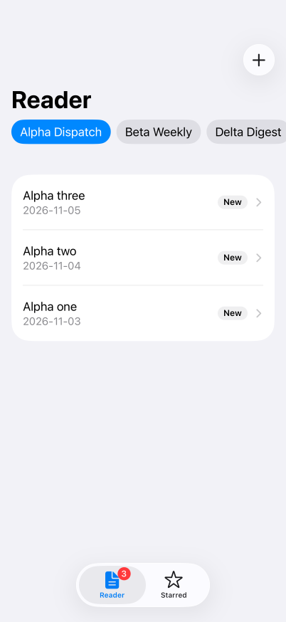
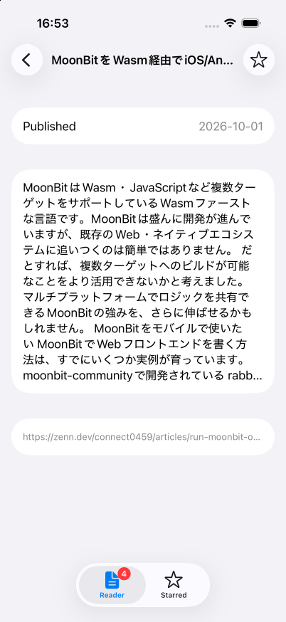

# exp-exact-rss-reader

[](https://github.com/connect0459/exp-exact-rss-reader/actions/workflows/ci.yml)
[](https://github.com/connect0459/exp-exact-rss-reader/blob/main/LICENSE)
[](https://github.com/expo/exact)
[](#compatibility)




A small RSS reader written as a trial of [Exact](https://github.com/expo/exact), Expo's Rust-based app runtime: what a screen reads and writes is declared in `app.contract`, answered by `app.ts`, and the same plan runs on web, macOS, and iOS.

## Motivation

The article ["Expo Exact first impression"](https://zenn.dev/tellernovel_inc/articles/expo-exact-first-impression) claims that the data a screen depends on can be declared (`resource`, `mutation ... refreshes`, `grants`) instead of fetched imperatively, which makes the dependencies checkable and the tests deterministic.

This project tests that claim on an app whose data is genuinely read and written. It is not a product and not a general RSS engine; the findings it produced are the point, and they are recorded in [docs/todo.md](https://github.com/connect0459/exp-exact-rss-reader/blob/main/docs/todo.md).

## Features

- Two tabs, each with its own navigation stack: **Reader** (a feed chooser, the selected feed's entries, an entry's detail) and **Starred**
- Unread marks and an unread count, kept across relaunches along with the chosen feed
- Starring an entry from either tab; one mutation refreshes both lists
- Adding a feed by its address, with a reason shown when the address has no feed
- A failed feed says so and offers a retry
- Reads the maintainer's [Zenn feed](https://zenn.dev/connect0459/feed) over `net.fetch`; every test runs offline on fixtures

## Installation

Exact is used from a source checkout placed next to this repository; it has no packaged CLI. Its setup needs [Bun](https://bun.sh/) 1.4.2 or later on your `PATH`.

```sh
git clone https://github.com/expo/exact.git
cd exact
bun scripts/exact.mjs setup
cd ..

git clone https://github.com/connect0459/exp-exact-rss-reader
cd exp-exact-rss-reader
just setup
```

`just setup` installs the pinned Bun through [mise](https://mise.jdx.dev/), installs the pre-commit hooks, and generates the types `app.ts` imports. The first macOS or iOS build takes ten to fifteen minutes; later ones take a minute or two.

## Usage

```sh
./exact.mjs web          # web dev loop, reloading on every save
./exact.mjs mac --run    # build and launch on this Mac
./exact.mjs ios --run    # build and launch on an iOS Simulator

just test                # app.test.contract on the web host
just verify              # the tests, then every screen checked in light and dark, at two widths and the largest text size
just check               # compile app.contract and print diagnostics as JSON
```

The web host cannot read the Zenn feed: the browser blocks it (no `Access-Control-Allow-Origin`) and the app shows its failure state. The macOS and iOS hosts read it.

## Project structure

| File | Role |
| :--- | :--- |
| `app.contract` | The view and every declaration: `shape`, `state`, `resource`, `mutation`, `action`, `routes` |
| `app.ts` | The data module: answers each declaration by name, persists state in `app:/data/state.json`, and holds the `grants` |
| `source.ts` | `fetchFeed(url)`, the only place that knows where feed text comes from |
| `rss.ts`, `entryId.ts`, `feedId.ts` | Pure helpers: an RSS 2.0 parser, route-safe entry ids, feed ids from addresses |
| `fixtures.ts` | The feeds the tests read, and the list of feeds the app starts with |
| `app.test.contract` | Tests with a driver-owned clock, query counts, and properties on each action's writes |
| `*.test.ts` | Unit tests for the pure helpers (`bun test`) |

## Compatibility

| Host | Status |
| :--- | :--- |
| Web | Tests and `verify` pass; the Zenn feed is blocked by CORS |
| macOS 14 and later | Tests pass; the Zenn feed is read |
| iOS 17 and later | Tests and `verify ios` pass on a simulator (iOS 26.5); the Zenn feed is read |

Building for macOS and iOS needs Xcode 27.1 or later. When the selected Xcode is older, point one command at a newer one with `DEVELOPER_DIR=/Applications/Xcode_27.2.app/Contents/Developer`.

## Limits

- Only RSS 2.0 is parsed; Atom is not
- `grants` admit `net.fetch https://zenn.dev` and nothing else, so addresses on other hosts are refused. A general reader would need `net.fetch https:`, which gives up the narrow grant
- `verify` reports the failure screen itself as one finding, because no `verify.accept` kind covers a failed resource
- Exact is pre-1.0 and its API is not stable; everything here is as of Exact commit `1aaab607`

## Documentation

- [docs/todo.md](https://github.com/connect0459/exp-exact-rss-reader/blob/main/docs/todo.md) — the decision log: what each milestone verified, what broke, and why. Start here for the findings about Exact.
- [AGENTS.md](https://github.com/connect0459/exp-exact-rss-reader/blob/main/AGENTS.md) — the guide for coding agents: structure, Exact conventions, development philosophy, and git conventions.

## Contributing

See [CONTRIBUTING.md](https://github.com/connect0459/exp-exact-rss-reader/blob/main/CONTRIBUTING.md).

## License

[Apache-2.0](https://github.com/connect0459/exp-exact-rss-reader/blob/main/LICENSE)
